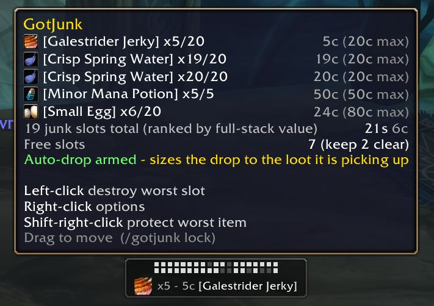

# GotJunk

An ever-present one-liner showing the **least valuable grey/white slot** in your bags:

```
[icon] x10 - 10c Worthless Sandals
```

**Left-click it to destroy that slot.** That's the whole addon.



Optionally it does it for you: tick an *auto-drop threshold* and, when fewer than N bag slots are free,
your next click on a loot item also destroys the worst junk slot — so you never see "Inventory is full".

Classic Era and WoW Forever.

## Display

- **LibDataBroker** data source `GotJunk` — shows up in ChocolateBar, Titan, Bazooka, ElvUI datatexts, etc.
- **Standalone panel** — draggable one-row frame. On first login it is shown only if no LDB display is
  detected; toggle any time with `/gotjunk` or in options.
- Minimap button (LibDBIcon), hideable.
- Tooltip lists the 5 worst slots, total junk value, free slots and auto-drop status.

| click | action |
|---|---|
| Left | destroy the shown slot |
| Ctrl-Left | **force** destroy the hovered slot when bags are not yet tight (the row says "no eligible junk", but hovering reveals the lowest slot in orange with a `(Ctrl)` tag; a plain click refuses) |
| hold Alt | rank by **current slot value** instead of full-stack value (row, tooltip and click all follow; combine with Ctrl) |
| Right | options |
| Shift-Right | protect the shown item (never offered again) |

## Settings (`/gotjunk options`)

**Food and water**
- ( ) Never junk food or water
- (x) Only junk low-level food and water (your level is 10+ above its required level — a better vendor tier exists)
  - [ ] Junk usable excess non-buff food/water — stacks to keep: 3
  - [x] Low-level buff food is junk eligible
  - [ ] Off-class buff food is junk eligible (e.g. Strength food on a Mage; stamina-only food is never off-class)

Buff food is anything whose tooltip grants *Well Fed*; detected automatically.

**Auto-drop thresholds**
- Slots to keep clear (default 1) — auto-drop is only considered while free slots are below this.
- [ ] Auto-drop below 10c slot max
- [ ] Auto-drop below 2% of all bag junk value

Both ticked = both must be true. Nothing ticked = never auto-drops.

Also: show junk when fewer than N slots free (default 3; the display stays quiet until bags are getting tight), show panel, hide minimap button, clear protected list.
**Panel** section: position and lock stored account wide (default) or per character, plus the lock checkbox.

## What counts as junk

Poor (grey) or Common (white) quality, vendor price above 0, not a quest item, not Hearthstone,
not protected. Ranked by **stack value** (price × count), lowest first.

## Why a click is needed

Blizzard requires a hardware event (mouse/key) for `DeleteCursorItem()` and allows one item per event.
GotJunk therefore destroys only inside your clicks — on its display, or on a loot button. Pure auto-loot
with no click cannot trigger it; when a drop is pending the display turns **red** instead.

## Slash

`/gotjunk` — toggle panel · `options` · `lock` · `reset` · `drop` · `scan` · `protect <itemlink|list>` · `status`

## License

MIT